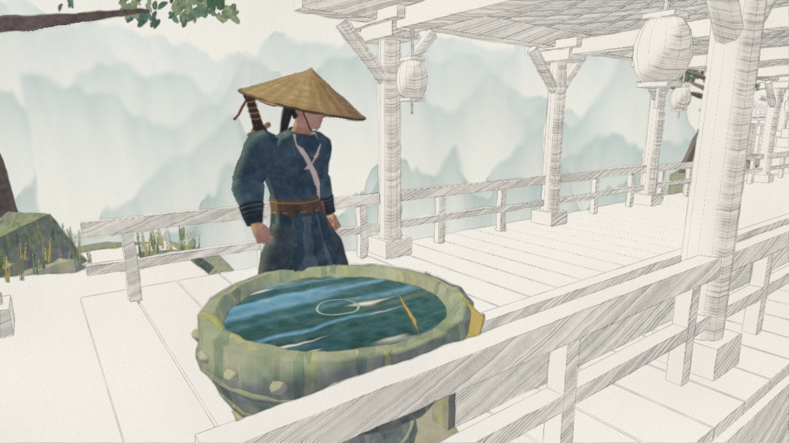

# 雨过山寺

一个用 Three.js 实时渲染的武侠水彩小品。戴斗笠的旅人站在山寺廊桥旁，拨动竹槽后，水流沿石槽而下，原先的铅笔线稿逐渐染上颜色。



## 运行

在仓库根目录使用 Node.js 24 和 npm 执行：

```sh
npm ci
npm run build
npm run serve
```

打开 <http://127.0.0.1:5483/> 即可体验。构建还会在仓库的上一级生成可双击离线运行的 **雨过山寺.html**。

点击竹槽、按 E 或选择「拨动竹槽」来引水。拖动画面可环视，滚轮控制距离。按 R 重新开始。「观看短片」使用与 MP4 相同的自动引水和三段运镜。浏览器在第一次交互后开启声音。

## 源码

以 Blendi / Patch 的 [Watercolour](https://patch.gg/blendi/watercolour) 为基础，原作提交为 `713908667b250c35598a737503e68b72cb9a2192`。沿用原作的颜料到达时间图、纸张后处理、铅笔排线、植被笔触和待机动画。武侠旅人使用原工程附带的成人模型，另做交领衣袍、竹斗笠、带鞘佩剑与拨槽动作。廊桥和山寺布局参考同一工作区的《山寺练习》。

- `src/rain-temple.js` 控制引水、镜头、操作和实时播放。
- `src/temple.js` 生成建筑、岩石、树、石钵和檐铃。
- `src/wayfarer.js` 生成并绑定服饰、斗笠和佩剑，控制引水时的手臂姿势。
- `src/temple-weather.js` 生成远山、檐滴和瀑流。
- `src/wash.js` 与 `src/page.js` 执行水彩渲染。引水沿石槽写入到达时间，廊柱从柱脚向上吸色。
- `src/temple-sound.js` 为实时播放与短片合成雨声、滴水和铜铃。
- [《过桥听雨》](public/audio/过桥听雨.m4a) 是为短片创作的 20 秒立体声配乐，用拨弦、气鸣和低鼓音色演奏。执行 `python tools/compose-temple.py` 可重新合成，依赖 NumPy、SciPy 与 FFmpeg。

## 重新构建

在此目录执行 `npm ci`，再执行 `npm run build`，会生成 `dist/` 和上一级的离线 HTML。执行 `npm run serve` 可通过本机 5483 端口预览。

执行 `node tools/temple-film.mjs` 会用本机 Chrome 或 Edge 与 FFmpeg 导出 1920 × 1080、30 fps 的 MP4。`--proof` 导出抽帧并测试引水、重置和回放。可通过 `CHROME` 指定浏览器路径。

原作许可证与素材来源见 [LICENSE](LICENSE)、[LICENCE-NOTES.md](LICENCE-NOTES.md) 和 [public/CREDITS.md](public/CREDITS.md)。

<details><summary>Watercolour 上游工程说明</summary>

---
kind: effect
engine: three.js
---

# Watercolour

A three.js world that begins as a pencil drawing on paper and is painted in watercolour as you walk through it. The wash spreads out from your feet with an uneven wet edge, climbs each tree from its roots to its leaves, runs off down the stream, and stays where you have been. The demo is the edge of a wood in the late afternoon, a stream with stepping stones, and a meadow going up to one tree in blossom, with a small girl in a red hooded cloak to bring the paint.


**In the demo:** click to look with the mouse, WASD to move, Shift to sprint, Space to jump, the wheel to step the eye back or in, H hides the hint. A gamepad works too. There is no sound.

Follow the path through the wood, cross the stream on the stones, and go up through the meadow to the tree in blossom: when you reach it, one last wash goes out over everything.


It is a starting point, not a filter. You can't lay it over a finished game: each thing in the world knows where it takes its paint from. Start from this scene, change it, replace it.

## The idea

Nothing is a photograph run through a filter. The page is drawn first and painted second, the way a watercolour is made.

- **A map of when the paint arrived.** `createWash()` (`src/wash.js`) keeps, for every spot of ground, the moment the wash reached it. `paint.touch(x, z, now)` puts paint down; `paint.flood()` sends one wave over everything.
- **Everything has a root.** Each vertex carries where it takes its paint from and how long colour takes to travel a metre of it. Ground is its own root, a tree's is its foot, a flower bed's is its middle, a far hill's is the nearest ground you can walk to. So a tree fills from the roots up, and a bed of poppies goes off at once.
- **Paint is pigment on paper.** A wash is what the pigment leaves of the paper's white: thin where the light falls, deeper where it pooled, settled into the paper's grain, uneven in soft clouds, darker while wet and darkest at its creeping edge. Shade is a second, violet glaze. Before the paint there is only pencil: an outline, and hatching where the shade will be.
- **Leaves, grass and petals are touches of a brush.** One touch lays down several small leaves, or a tuft of blades, or a flower with its petals, each a little more or less full of pigment and each arriving in its own moment. A tree is some thousands of touches, darkest inside and lightest toward the sun. The demo has about 650,000.
- **Wet into wet.** `src/page.js` decides where the paper was wet: everything far, and patches of the middle distance. There the paint runs together, but only into what lies about as far off, so the inside of a crown goes soft while its edge against the sky stays crisp. Wet paint is grainy, and pencil is never wet.
- **Hills are washes.** Five ranges, each one wash that is deepest along its crest and thins to mist, out of which the next stands.
- **Life follows colour.** Grass sways, the stream runs, petals fall and butterflies fly only once they are painted.

## Use it

```
npm install
npm run build        # dist/, the demo as it is published
npm run serve        # http://127.0.0.1:5483/
```

- `src/wash.js` is the paint: the map, the materials for solid things and for touches of the brush, the hills, the sunbeams. Start there.
- `src/page.js` is the sheet of paper: wet passages, the pencil's outline, the grain.
- `src/glade/world.js` puts the demo together: the ground and stream, the trees (`tree`, `fir`, `willow`, `bush`, each built from `clump`s of leaves), flowers and grass, the far wood and the hills, the light, and when the sky and the last wash are set off.
- `src/hood.js` is the girl, sewn onto a skeleton that walks, with a cloak that swings.
- `src/pencil.js` and `src/shape.js` are the pencil strokes and the soft solids things are built from.
- `?painted` shows the page finished from the start. `?wet=0` turns off the wet passages.

The tools in `tools/` take stills and films of the built demo with a headless Chromium (`CHROME` names one of your own): `sh tools/go.sh --name still` builds and takes one.

## What it costs

About 4 to 6 ms a frame at 1080p on a fast desktop card, and about 4.5 s to build the world when it loads. It has not been measured on a laptop. The demo is about 9 MB to download: the girl's skeleton and clips are 3.6 MB of it and the physics engine 2 MB.

## Licence

Code MIT, art CC0 1.0. Everything painted is made in code. The girl moves on Patch's starter man's skeleton with clips from Quaternius' Universal Animation Library and Patch's own, all CC0. Physics is Rapier (Apache-2.0). `LICENCE-NOTES.md` has every part and where it came from.

</details>
